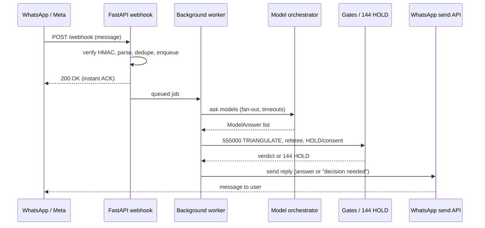

# WhatsApp fast-ACK webhook — design sketch

**Status:** DESIGN SKETCH, NOT IMPLEMENTED, NOT INDEPENDENTLY REVIEWED.  
**Scope:** SYNTH_SHAI offline research prototype. No live deployment authorisation.  
**Prepared:** 27 October 2026, against `main` at `406440d`.

## Flow

Asking several models can take 3–10+ seconds, and Meta retries a webhook that isn't answered quickly. So the webhook acknowledges at once and replies later in a separate message.

1. WhatsApp (Meta Cloud API) POSTs the incoming message to the FastAPI webhook.
2. The webhook does only cheap checks (below), queues the work and returns **HTTP 200** immediately.
3. A background worker calls the model orchestrator (one or many models, e.g. `/all`).
4. Results pass through `555000 TRIANGULATE`, the disagreement referee, and the HOLD/consent gates.
5. A **separate** reply is sent with the WhatsApp send-message API: an answer, or on `144 HOLD` a request for Mitch's decision.



## Before the ACK (cheap work only)

- **One-time setup:** `GET /webhook` verify-token handshake. Echo `hub.challenge` only if `hub.verify_token` equals `VERIFY_TOKEN`.
- **Verify the signature:** check `X-Hub-Signature-256` (HMAC-SHA256 of the raw body with `APP_SECRET`) using a constant-time compare. If it doesn't match, return 403 and process nothing.
- **Parse** the payload, and **dedupe** by WhatsApp message `id`, since Meta re-delivers when it gets no fast 200.
- **Parse commands** such as `/all`.
- **Enqueue** the job and **return 200**. No model calls before the ACK.

## Background work

- **Prototype:** FastAPI `BackgroundTasks`. These are lost if the process restarts, so they are acceptable only for the echo/test phase.
- **Later:** a durable queue (e.g. Redis + RQ, or Celery) with retries and its own dedupe.
- **Fan-out:** `asyncio.gather` across models, with a **per-model timeout**. A timeout is recorded as `no_answer` and never counted as agreement.

## Where the unified model API plugs in

A `ModelClient` interface, `async def ask(prompt: str, timeout: float) -> ModelAnswer`, with one adapter per provider. The orchestrator calls the adapters and returns a list of `ModelAnswer` objects (model name + version, text, status). The answers then go to:

- `555000 TRIANGULATE`;
- the disagreement referee ([DISAGREEMENT_REFEREE_SPEC.md](DISAGREEMENT_REFEREE_SPEC.md), **pending in PR #51**);
- the HOLD and consent gates;
- only then, the reply.

`144 HOLD` means the reply asks Mitch for a decision instead of answering.

## Illustrative code sketch (not wired into the repo)

```python
# ILLUSTRATIVE ONLY - not part of SYNTH_SHAI, untested, no real numbers or data.
import hashlib, hmac, os
from fastapi import BackgroundTasks, FastAPI, HTTPException, Request
from fastapi.responses import PlainTextResponse

APP_SECRET = os.environ["APP_SECRET"]          # never hardcode secrets
VERIFY_TOKEN = os.environ["VERIFY_TOKEN"]
WHATSAPP_TOKEN = os.environ["WHATSAPP_TOKEN"]
app = FastAPI()
seen_ids = set()                               # prototype only; use a durable store later

@app.get("/webhook")
def verify(request: Request):
    q = request.query_params
    if q.get("hub.mode") == "subscribe" and q.get("hub.verify_token") == VERIFY_TOKEN:
        return PlainTextResponse(q.get("hub.challenge", ""))
    raise HTTPException(403)

@app.post("/webhook")
async def webhook(request: Request, tasks: BackgroundTasks):
    body = await request.body()
    sent = request.headers.get("X-Hub-Signature-256", "")
    good = "sha256=" + hmac.new(APP_SECRET.encode(), body, hashlib.sha256).hexdigest()
    if not hmac.compare_digest(sent, good):
        raise HTTPException(403)
    for msg in extract_messages(await request.json()):   # parse helper (not shown)
        if msg["id"] in seen_ids:
            continue                                     # Meta retry: already queued
        seen_ids.add(msg["id"])
        tasks.add_task(handle_message, msg["from"], msg["text"])
    return {"status": "ok"}                               # instant 200 ACK

async def handle_message(sender: str, text: str):
    models = "all" if text.startswith("/all") else "default"
    answers = await orchestrator.ask_all(text, models=models, timeout=10.0)  # ModelClient fan-out
    verdict = run_gates(answers)       # 555000 TRIANGULATE -> referee -> HOLD/consent
    if verdict.hold:
        reply = "144 HOLD - your decision is needed: " + verdict.summary
    else:
        reply = verdict.text + ("\n" + verdict.disagreement_note if verdict.disagreement_note else "")
    await send_reply(sender, reply, token=WHATSAPP_TOKEN)  # WhatsApp send-message API
```

## Limits and non-goals

- **Not implemented.** The echo bot (step 2 of the WhatsApp plan) comes first, and none of this exists yet.
- **Meta test number only, synthetic data only.** No real contacts or personal data.
- **No medical or emergency use.** This is not a medical device and not a safety system. In an emergency in Australia, call 000.
- **Approval over WhatsApp does not authenticate a human.** A reply such as "approve" is caller-asserted text; see [THREAT_MODEL.md](THREAT_MODEL.md).
- **In-process limits still apply.** `BackgroundTasks` and the in-memory dedupe set are lost on restart; real use needs a durable queue and store.
